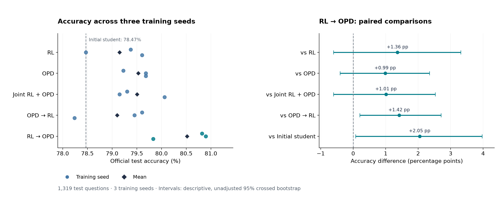

# Reinforcement Learning and On-Policy Distillation

**How should task reward and teacher feedback be combined when training time is limited?**

This study compares five post-training strategies for Qwen3-1.7B on GSM8K, using Qwen3-4B as a frozen teacher. Each strategy receives the same two-hour training allowance and is evaluated across three training seeds.

**RL followed by OPD achieved the highest observed mean test accuracy, 80.52%, a 2.05 percentage-point gain over the initial student.** Differences from RL alone, OPD alone, and joint training remain uncertain.

[Results](#results) · [Methods](docs/methods.md) · [Reproduce the analysis](#reproduce-the-analysis) · [Training setup](docs/reproduction.md)

## Results



| Strategy | Training signal | Mean test accuracy | Seed SD |
| :--- | :--- | ---: | ---: |
| Initial student | No post-training | 78.47% | — |
| RL | Final-answer reward | 79.15% | 0.60 pp |
| OPD | Teacher feedback on student responses | 79.53% | 0.26 pp |
| Joint RL and OPD | Both signals in each update | 79.50% | 0.49 pp |
| OPD followed by RL | Teacher feedback, then task reward | 79.10% | 0.75 pp |
| RL followed by OPD | Task reward, then teacher feedback | **80.52%** | 0.59 pp |

Accuracy is measured on all 1,319 official test questions using greedy decoding and a fixed numerical-answer parser. SD is the sample standard deviation across seeds 42, 43, and 44; pp means percentage points.

RL followed by OPD improved on the baseline by **2.05 pp**, with a descriptive 95% paired bootstrap interval of **[0.08, 3.97] pp**. Its advantage over the reverse ordering was **1.42 pp [0.20, 2.70]**. The intervals against RL, OPD, and joint training include zero. These intervals are unadjusted for multiple comparisons.

Full tables: [every seed](results/method_results.csv), [all paired comparisons](results/paired_contrasts.csv), [46 evaluations](results/evaluation_results.csv), and [training costs](results/training_costs.csv).

## Experimental design

| Component | Setting |
| :--- | :--- |
| Models | Qwen3-1.7B student; frozen Qwen3-4B teacher |
| Data | 6,961 training, 512 development, and 1,319 test questions |
| Runs | Five strategies, three matched training seeds, one shared initial adapter |
| Adaptation | LoRA rank 16, alpha 32, dropout 0 |
| Optimizer | AdamW, learning rate 1e-5, constant schedule |
| Batch | Four questions, four sampled answers per question |
| Generation | Non-thinking mode; at most 1,024 new tokens |
| Budget | 120-minute training ceiling; 112.02–114.21 minutes actually consumed |
| Hardware | One RTX 5090; Ubuntu under WSL2 |
| Analysis | 20,000 paired bootstrap resamples across training seeds and test questions |

All methods sample fresh responses from the current student. Sequential methods switch after the first completed batch reaching 60 charged minutes and retain optimizer state. Checkpoints are selected by the time rule; development and test scores do not select the reported endpoints.

The training clock includes generation, teacher scoring, optimization, and work performed within each committed batch. Loading and evaluation are recorded separately. This compares a common training-time allowance on fixed hardware; actual consumed time and token counts vary by method.

## Implementation

The project integrates the **verl FSDP engine** at world size one with a synchronous training controller. Hugging Face generates student responses and scores their tokens with the frozen teacher. The RL arm uses group-relative reward advantages; OPD uses a detached teacher-minus-student log-probability signal. [The method description](docs/methods.md) gives the equations and update rules.

The implementation covers:

- A shared training loop for the five objectives and schedules.
- Numerical-answer scoring, fixed data splits, and reproducible sampling.
- Checks of source versions, model state, checkpoints, and evaluation records.
- Paired statistical analysis and separate training and evaluation cost accounting.

### Where to read the code

| File | Purpose |
| :--- | :--- |
| [train_verl_study.py](experiments/verl_study/train_verl_study.py) | Generate responses, construct signals, update the student, and charge training time |
| [verl_engine_bridge.py](experiments/verl/verl_engine_bridge.py) | Connect the objective to verl's scoring and optimization engine |
| [study_schedule.py](experiments/verl_study/study_schedule.py) | Select phases and enforce the training allowance |
| [text_answer_reward.py](experiments/reward/text_answer_reward.py) | Parse and score final numerical answers |
| [reproduce_results.py](scripts/reproduce_results.py) | Recompute the public statistics from question-level outcomes |

The original frozen experiment files remain in `experiments/`. Public preparation and analysis commands live in `scripts/`.

## Reproduce the analysis

Python 3.12 is recommended. This step uses the released outcomes and requires no GPU or model download.

```bash
python -m pip install -r requirements-analysis.txt
python scripts/reproduce_results.py --check
```

The command checks the released tables and writes regenerated copies to `artifacts/reproduced`. To redraw the figure from those copies:

```bash
python -m pip install -r requirements-figures.txt
python scripts/plot_results.py --results-dir artifacts/reproduced --output artifacts/results.png
```

See [reproduction instructions](docs/reproduction.md) for data preparation, environment checks, and training. The [results guide](docs/results.md) describes the released records and uncertainty estimates.

## Scope

The experiment covers one model pair, GSM8K, one joint-loss weight, and one switching rule. The three training seeds vary data order and sampling while sharing the initial adapter. The results motivate further tests of switching time, objective weighting, and training duration.

## References

- [GSM8K](https://github.com/openai/grade-school-math): benchmark data.
- [Qwen3](https://huggingface.co/Qwen/Qwen3-1.7B): student and teacher models.
- [verl / HybridFlow](https://github.com/verl-project/verl): training engine.
- [On-Policy Distillation of Language Models](https://arxiv.org/abs/2306.13649): related work on learning from student-generated responses.

Model revisions, framework versions, and experiment settings are recorded in the [study protocol](experiments/verl_study/protocol.json). Citation metadata is available in [CITATION.cff](CITATION.cff).
